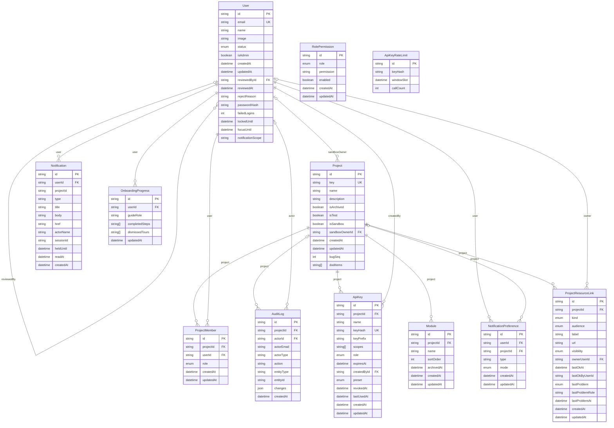
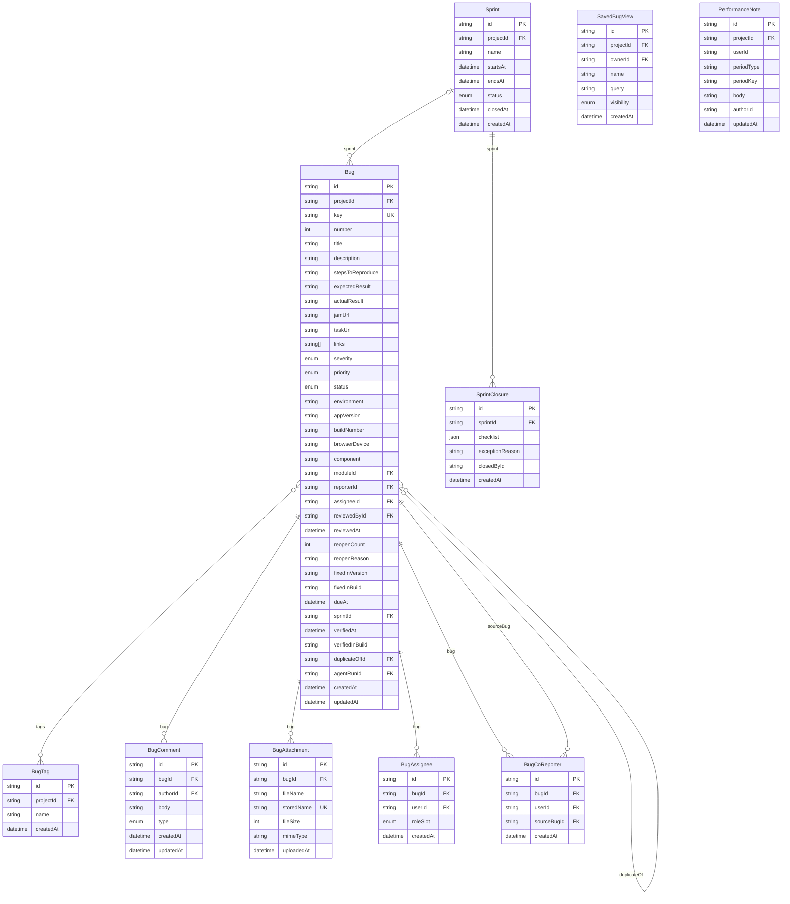
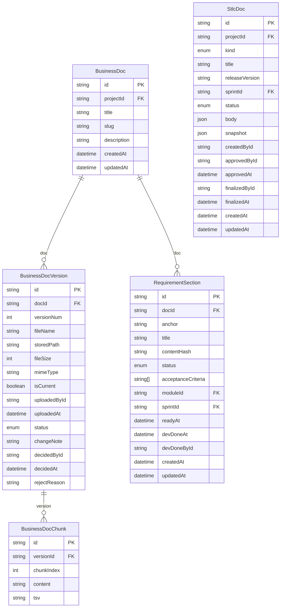
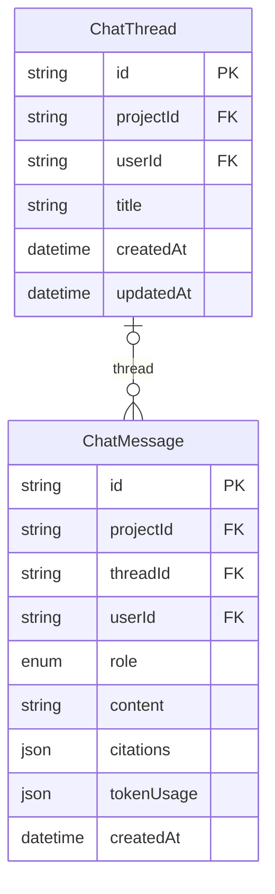

# Grafik relasi database

Dibuat otomatis dari `prisma/schema.prisma` (37 tabel). Jangan diedit tangan; jalankan `npx tsx scripts/gen-erd.ts` setelah mengubah skema.

Keterangan: `PK` primary key, `FK` foreign key, `UK` unique. Garis `||--o{` = satu ke banyak, `|o--o{` = satu ke banyak dengan induk opsional, `}o--o{` = banyak ke banyak.

## Ringkasan seluruh tabel (relasi saja)

```mermaid
erDiagram
  User |o--o{ User : "reviewedBy"
  User |o--o{ Project : "sandboxOwner"
  Project ||--o{ ProjectMember : "project"
  User ||--o{ ProjectMember : "user"
  Project ||--o{ Sprint : "project"
  Project ||--o{ Bug : "project"
  Bug }o--o{ Bug : "related"
  Module |o--o{ Bug : "module"
  User ||--o{ Bug : "reporter"
  User |o--o{ Bug : "assignee"
  User |o--o{ Bug : "reviewedBy"
  Sprint |o--o{ Bug : "sprint"
  Bug |o--o{ Bug : "duplicateOf"
  AgentRun |o--o{ Bug : "agentRun"
  Bug }o--o{ BugTag : "tags"
  Bug ||--o{ BugComment : "bug"
  User ||--o{ BugComment : "author"
  Bug ||--o{ BugAttachment : "bug"
  Bug ||--o{ BugAssignee : "bug"
  User ||--o{ BugAssignee : "user"
  Bug ||--o{ BugCoReporter : "bug"
  User ||--o{ BugCoReporter : "user"
  Bug ||--o{ BugCoReporter : "sourceBug"
  Project |o--o{ AuditLog : "project"
  User |o--o{ AuditLog : "actor"
  Project ||--o{ BusinessDoc : "project"
  BusinessDoc ||--o{ BusinessDocVersion : "doc"
  BusinessDocVersion ||--o{ BusinessDocChunk : "version"
  Project ||--o{ TestCase : "project"
  Module |o--o{ TestCase : "module"
  RequirementSection |o--o{ TestCase : "section"
  TestCase ||--o{ TestCaseVersion : "testCase"
  User |o--o{ TestCaseVersion : "createdBy"
  Project ||--o{ TestRun : "project"
  User ||--o{ TestRun : "createdBy"
  User |o--o{ TestRun : "closedBy"
  TestRun ||--o{ TestRunItem : "testRun"
  TestCase ||--o{ TestRunItem : "testCase"
  User |o--o{ TestRunItem : "executedBy"
  TestCaseVersion |o--o{ TestRunItem : "testCaseVersion"
  Bug |o--o{ TestRunItem : "rerunBug"
  User |o--o{ TestRunItem : "runningBy"
  TestRunItem ||--o{ TestRunAttempt : "item"
  TestCaseVersion |o--o{ TestRunAttempt : "testCaseVersion"
  User |o--o{ TestRunAttempt : "executedBy"
  AgentRun |o--o{ TestRunAttempt : "agentSession"
  Project ||--o{ Evidence : "project"
  TestRunAttempt |o--o{ Evidence : "attempt"
  TestRunItem ||--o{ TestRunItemBug : "item"
  Bug ||--o{ TestRunItemBug : "bug"
  TestRunAttempt |o--o{ TestRunItemBug : "attempt"
  Project ||--o{ ApiKey : "project"
  User ||--o{ ApiKey : "createdBy"
  Project ||--o{ AgentRun : "project"
  ApiKey |o--o{ AgentRun : "apiKey"
  TestRun |o--o{ AgentRun : "testRun"
  Project ||--o{ ChatThread : "project"
  User ||--o{ ChatThread : "user"
  Project ||--o{ ChatMessage : "project"
  ChatThread |o--o{ ChatMessage : "thread"
  User ||--o{ ChatMessage : "user"
  Project ||--o{ Module : "project"
  User ||--o{ Notification : "user"
  User ||--o{ NotificationPreference : "user"
  Project |o--o{ NotificationPreference : "project"
  Project ||--o{ ProjectResourceLink : "project"
  User |o--o{ ProjectResourceLink : "owner"
  BusinessDoc ||--o{ RequirementSection : "doc"
  Module |o--o{ RequirementSection : "module"
  Sprint |o--o{ RequirementSection : "sprint"
  Project ||--o{ StlcDoc : "project"
  Sprint |o--o{ StlcDoc : "sprint"
  Sprint ||--o{ SprintClosure : "sprint"
  Project ||--o{ PerformanceNote : "project"
  User ||--o{ OnboardingProgress : "user"
  Project ||--o{ SavedBugView : "project"
  User ||--o{ SavedBugView : "owner"
  Project ||--o{ BugTag : "project"
```

## Pengguna, project, dan akses

## Bug dan kolaborasi

## Test case dan test run

```mermaid
erDiagram
  TestCase ||--o{ TestCaseVersion : "testCase"
  TestRun ||--o{ TestRunItem : "testRun"
  TestCase ||--o{ TestRunItem : "testCase"
  TestCaseVersion |o--o{ TestRunItem : "testCaseVersion"
  TestRunItem ||--o{ TestRunAttempt : "item"
  TestCaseVersion |o--o{ TestRunAttempt : "testCaseVersion"
  AgentRun |o--o{ TestRunAttempt : "agentSession"
  TestRunAttempt |o--o{ Evidence : "attempt"
  TestRunItem ||--o{ TestRunItemBug : "item"
  TestRunAttempt |o--o{ TestRunItemBug : "attempt"
  TestRun |o--o{ AgentRun : "testRun"
  TestCase {
    string id PK
    string projectId FK
    string code
    string moduleArea
    string moduleId FK
    string title
    enum status
    enum priority
    string testType
    string targetRole
    string precondition
    string steps
    string expectedResult
    string referenceUrl
    boolean agentReady
    json testData
    datetime createdAt
    datetime updatedAt
    string sectionId FK
  }
  TestCaseVersion {
    string id PK
    string testCaseId FK
    int version
    string changelog
    json snapshot
    string createdById FK
    datetime createdAt
  }
  TestRun {
    string id PK
    string projectId FK
    string name
    string environment
    string buildVersion
    enum status
    string createdById FK
    datetime createdAt
    datetime updatedAt
    enum decision
    string decisionNote
    datetime closedAt
    string closedById FK
  }
  TestRunItem {
    string id PK
    string testRunId FK
    string testCaseId FK
    enum status
    string actualResult
    string notes
    string executedById FK
    datetime executedAt
    string skipReason
    string testCaseVersionId FK
    boolean needsRerun
    string rerunBuild
    string rerunBugId FK
    string runningByUserId FK
    string runningAgentName
    datetime runningSince
    datetime heartbeatAt
    datetime leaseExpiresAt
    int currentStep
    int totalSteps
  }
  TestRunAttempt {
    string id PK
    string itemId FK
    int seq
    enum result
    string actualResult
    int failedStep
    string notes
    string build
    string environment
    string evidenceUrl
    string testCaseVersionId FK
    string executedById FK
    boolean viaAgent
    string agentName
    string toolName
    string agentSessionId FK
    datetime createdAt
  }
  TestRunItemBug {
    string itemId FK
    string bugId FK
    string attemptId FK
    datetime createdAt
  }
  Evidence {
    string id PK
    string projectId FK
    string uploadedById
    string sessionId
    string fileName
    string storedName
    string mimeType
    int fileSize
    string attemptId FK
    datetime purgedAt
    datetime createdAt
  }
  AgentRun {
    string id PK
    string projectId FK
    string apiKeyId FK
    string agentName
    string modelName
    string runId
    enum status
    datetime createdAt
    string toolName
    string workdir
    string testRunId FK
    datetime startedAt
    datetime finishedAt
    json summary
  }
```

## Dokumen bisnis dan STLC

## Chat

